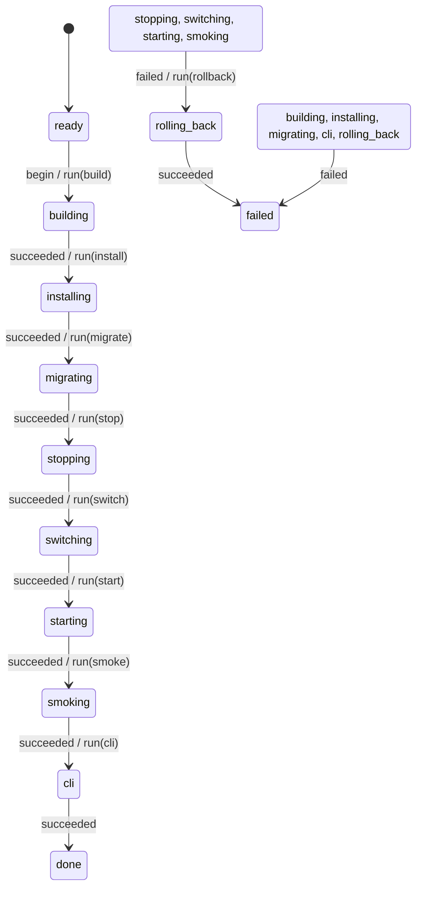

# deploy_lifecycle

Generated by `mix foreman.fsm.docs`. Do not edit by hand.

| state | event | result | effects |
| --- | --- | --- | --- |
| ready | begin | -> building | run(build) |
| ready | succeeded | invalid |  |
| ready | failed | invalid |  |
| building | begin | invalid |  |
| building | succeeded | -> installing | run(install) |
| building | failed | -> failed |  |
| installing | begin | invalid |  |
| installing | succeeded | -> migrating | run(migrate) |
| installing | failed | -> failed |  |
| migrating | begin | invalid |  |
| migrating | succeeded | -> stopping | run(stop) |
| migrating | failed | -> failed |  |
| stopping | begin | invalid |  |
| stopping | succeeded | -> switching | run(switch) |
| stopping | failed | -> rolling_back | run(rollback) |
| switching | begin | invalid |  |
| switching | succeeded | -> starting | run(start) |
| switching | failed | -> rolling_back | run(rollback) |
| starting | begin | invalid |  |
| starting | succeeded | -> smoking | run(smoke) |
| starting | failed | -> rolling_back | run(rollback) |
| smoking | begin | invalid |  |
| smoking | succeeded | -> cli | run(cli) |
| smoking | failed | -> rolling_back | run(rollback) |
| cli | begin | invalid |  |
| cli | succeeded | -> done |  |
| cli | failed | -> failed |  |
| rolling_back | begin | invalid |  |
| rolling_back | succeeded | -> failed |  |
| rolling_back | failed | -> failed |  |
| done | begin | invalid |  |
| done | succeeded | invalid |  |
| done | failed | invalid |  |
| failed | begin | invalid |  |
| failed | succeeded | invalid |  |
| failed | failed | invalid |  |
